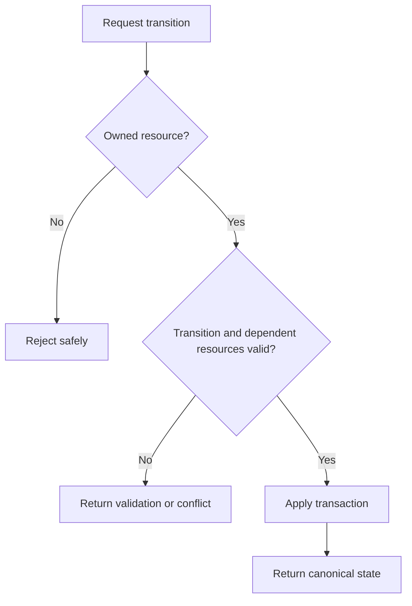

# แนวทาง Activity: Project Status

ใช้เมื่อเปลี่ยน feature ที่กระทบมุมมองนี้ อ่าน [กฎ diagrams](README.md) และ [feature workflow](../feature-workflow.md) ร่วมกัน

## กฎ implementation และ review

- อ่าน allowed transitions และ policy จริงจาก service/domain ก่อนวาด ไม่อนุญาต transition ใหม่เพราะ diagram มีลูกศร
- ตรวจ owner, project availability และผลต่อ tasks/timer/time history ก่อน write
- invalid input กับ stale version เป็นคนละ outcome ต้องมี recovery ที่เหมาะสม
- เปลี่ยน/ลบ state ต้องประเมิน records เดิม, filters, enum consumers, migration/backfill และ regression tests

## ตัวอย่างเพื่อสื่อสารแนวทาง

ก่อนนำไปใช้เป็น diagram ปัจจุบัน ให้ระบุ source/commit ที่ตรวจและปรับ edges/guards ให้ตรง tests ตัวอย่างไม่แทน schema หรือสัญญา API
