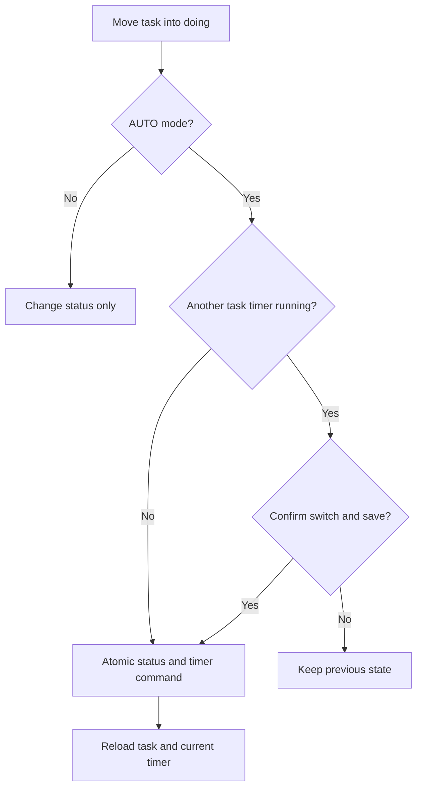

# แนวทาง Activity: Timer และ Board

ใช้เมื่อเปลี่ยน feature ที่กระทบมุมมองนี้ อ่าน [กฎ diagrams](README.md) และ [feature workflow](../feature-workflow.md) ร่วมกัน

## กฎ implementation และ review

- AUTO/MANUAL ต้องใช้กฎ owner/availability/timer เดียวกัน ไม่ทำ start/stop จาก UI อย่างอิสระจนเกิด partial writes
- มี timer อื่นต้องเลือก switch-and-save หรือ cancel ไม่สลับเงียบ ๆ; same-column reorder ไม่เริ่ม timer ใหม่
- MANUAL ต้องหยุด timer ก่อนย้าย active task ออกจากกำลังทำ; เปลี่ยน mode ไม่แตะ timer ที่วิ่ง
- API failure ต้อง rollback writes และ UI โหลดข้อมูลจริง รวมกรณี stop สำเร็จแต่ response หาย
- เพิ่ม/แก้/ลบ timer action ต้องทดสอบ one-running-timer invariant, elapsed duration, conflict และ transaction failure

## ตัวอย่างเพื่อสื่อสารแนวทาง

ก่อนนำไปใช้เป็น diagram ปัจจุบัน ให้ระบุ source/commit ที่ตรวจและปรับ edges/guards ให้ตรง tests ตัวอย่างไม่แทน schema หรือสัญญา API
