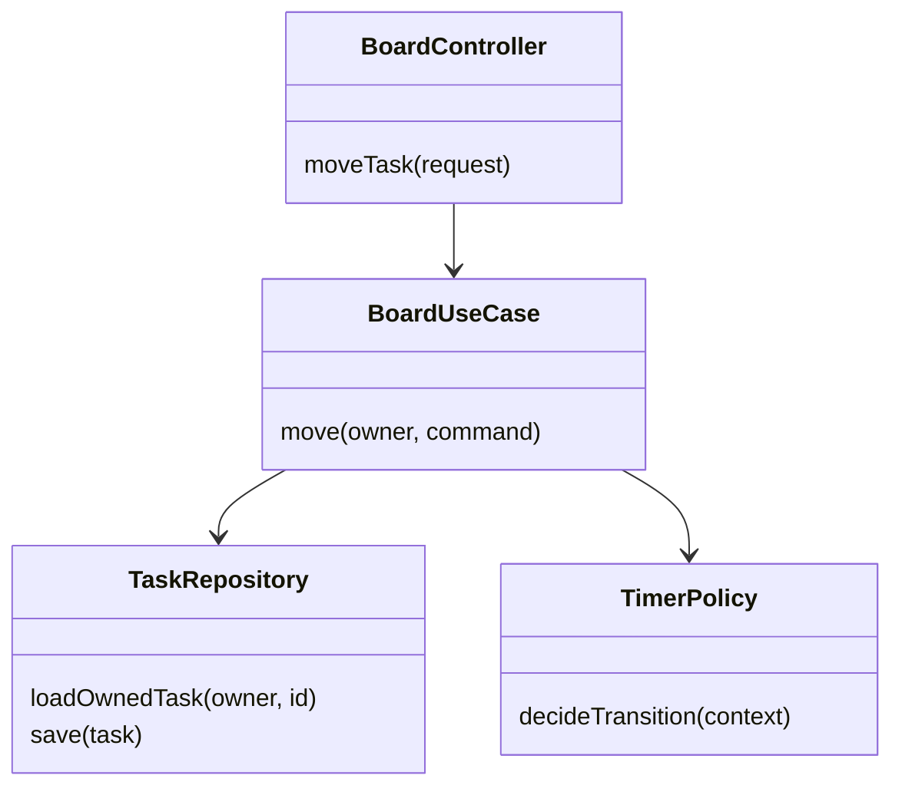

# แนวทาง Class และ Responsibility

ใช้เมื่อเปลี่ยน feature ที่กระทบมุมมองนี้ อ่าน [กฎ diagrams](README.md) และ [feature workflow](../feature-workflow.md) ร่วมกัน

## กฎ implementation และ review

- แสดง contract/implementation/dependency ที่ช่วย review ไม่คัดทุก getter/entity property
- Controller พึ่ง service; service พึ่ง persistence boundary และ policy ที่จำเป็น ไม่ใส่ SQL/orchestration ใน controller ใหม่
- ระบุ interface เพื่อ boundary/variation ที่จริง ไม่สร้าง implementation pair ทุก class เพื่ออ้าง SOLID
- เพิ่ม/แก้ operation ต้องตรวจ SRP/LSP/ISP และ contract tests; ลบ feature ต้องถอน dead implementations/registrations โดยคง consumer contracts ที่เหลือ
- แผนภาพตัวอย่างเป็นเป้าหมายการแยกชั้น ไม่ใช่คำกล่าวว่า controllers เดิมแยกครบแล้ว

## ตัวอย่างเพื่อสื่อสารแนวทาง

ก่อนนำไปใช้เป็น diagram ปัจจุบัน ให้ระบุ source/commit ที่ตรวจและปรับ edges/guards ให้ตรง tests ตัวอย่างไม่แทน schema หรือสัญญา API
