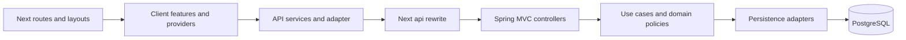

# แนวทาง Component และ Dependency Boundaries

ใช้เมื่อเปลี่ยน feature ที่กระทบมุมมองนี้ อ่าน [กฎ diagrams](README.md) และ [feature workflow](../feature-workflow.md) ร่วมกัน

## กฎ implementation และ review

- ระบุ responsibility/runtime ไม่ผสม deployment servers กับ class details
- Next route/layout ประกอบ client features; features เรียก service/api adapter ผ่าน same-origin proxy
- Spring controller รับ HTTP; service/domain เป็น use case rules; repository จัด persistence
- Diagram เป็น target boundary: code เดิมที่ผูก SQL กับ controller ต้องระบุ gap เมื่อแตะ ไม่ claim ว่าผ่าน architecture แล้ว
- เพิ่ม/แก้/ลบ component ให้ระบุ public contract, consumers, lifecycle, state cleanup และ tests

## ตัวอย่างเพื่อสื่อสารแนวทาง

ก่อนนำไปใช้เป็น diagram ปัจจุบัน ให้ระบุ source/commit ที่ตรวจและปรับ edges/guards ให้ตรง tests ตัวอย่างไม่แทน schema หรือสัญญา API
