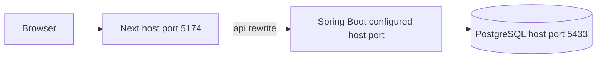

# แนวทาง Runtime และ Configuration

ใช้เมื่อเปลี่ยน feature ที่กระทบมุมมองนี้ อ่าน [กฎ diagrams](README.md) และ [feature workflow](../feature-workflow.md) ร่วมกัน

## กฎ implementation และ review

- เอกสาร topology ต้องอิง configuration จริง ไม่สร้าง public URL หรือ claim ว่า deploy แล้ว
- host ports: Frontend 5174, PostgreSQL 5433; Backend Compose ใช้ APP_PORT (default 8080 ใน working tree นี้), Spring โดยตรงมี default 8081 ตรวจ container port และ proxy จาก config จริง
- browser ใช้ `/api`; BACKEND_ORIGIN อยู่ฝั่ง server และต้อง rebuild เมื่อเปลี่ยน production rewrite
- PostgreSQL/secret/cookie configuration ของ FreelanceFlow แยกจากต้นฉบับ; HTTPS/secure/origin ต้องออกแบบตาม environment จริง
- เพิ่ม/แก้/ลบ service ต้องตรวจ health, migration, backup/recovery, volumes, env examples, CI และ consumers; deploy เป็นงานแยก

## ตัวอย่างเพื่อสื่อสารแนวทาง

ก่อนนำไปใช้เป็น diagram ปัจจุบัน ให้ระบุ source/commit ที่ตรวจและปรับ edges/guards ให้ตรง tests ตัวอย่างไม่แทน schema หรือสัญญา API
