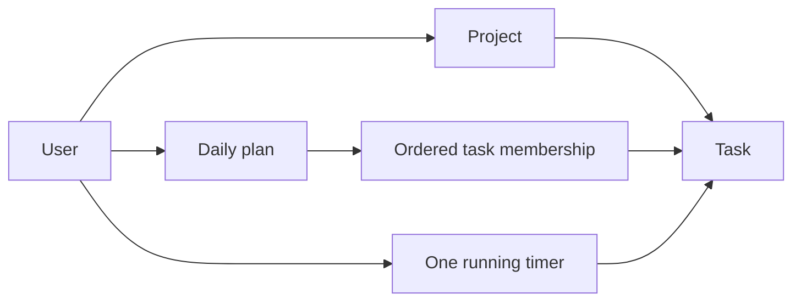

# แนวทาง Domain Model

ใช้เมื่อเปลี่ยน feature ที่กระทบมุมมองนี้ อ่าน [กฎ diagrams](README.md) และ [feature workflow](../feature-workflow.md) ร่วมกัน

## กฎ implementation และ review

- แยก concepts จาก DTO/JPA details และระบุ owner/parent/invariants
- Task status, daily-plan membership และ running timer เป็นคนละ concept ห้ามรวม Today เป็น Task status
- ก่อนเพิ่มการเงิน ให้กำหนด amount/currency/invoice/payment relationships และ lifecycle จริง
- เมื่อแก้/ลบ concept ให้ตรวจ historical records, reports, related policies และ retention

## ตัวอย่างเพื่อสื่อสารแนวทาง

ก่อนนำไปใช้เป็น diagram ปัจจุบัน ให้ระบุ source/commit ที่ตรวจและปรับ edges/guards ให้ตรง tests ตัวอย่างไม่แทน schema หรือสัญญา API
