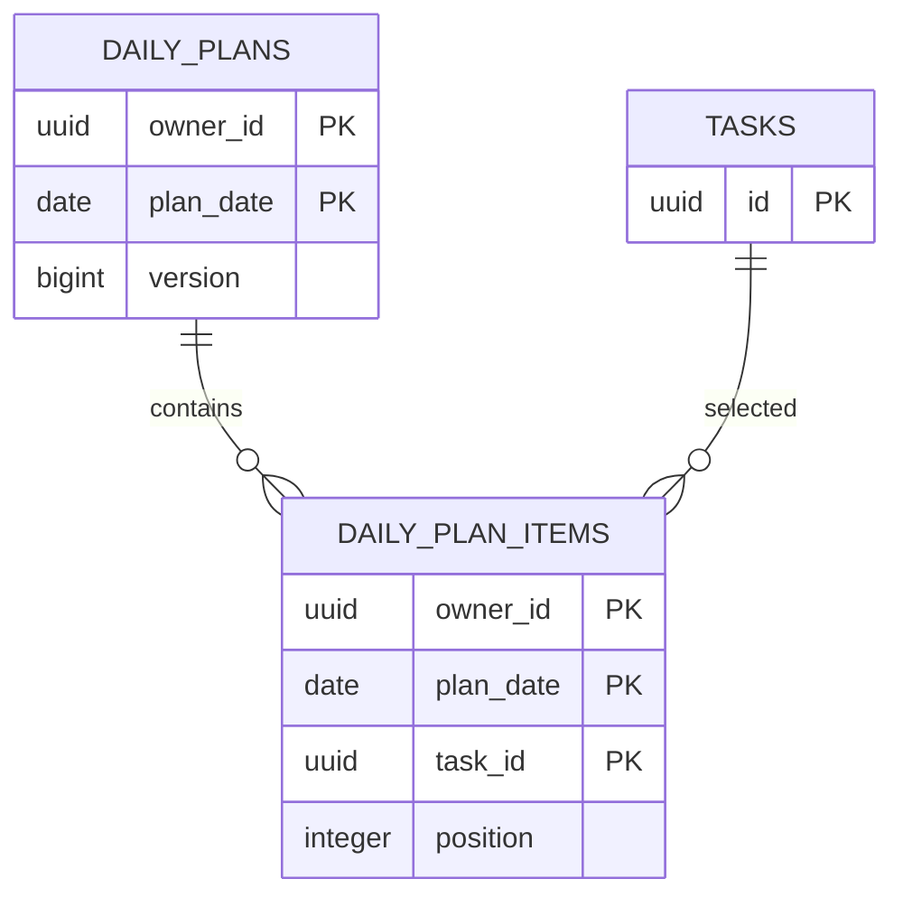

# แนวทาง ER และ Schema

ใช้เมื่อเปลี่ยน feature ที่กระทบมุมมองนี้ อ่าน [กฎ diagrams](README.md) และ [feature workflow](../feature-workflow.md) ร่วมกัน

## กฎ implementation และ review

- ดึงชื่อ/type/keys จริงจาก migrations; proposed tables ต้องติดป้าย proposed ไม่ประกาศว่า implement แล้ว
- แสดง FK, cardinality, nullable/unique และ deletion policy พร้อม owner scope ที่ query ต้องตรวจ
- daily_plans ใช้ composite owner/date; items มี unique position และ task ต่อแผน; version ต้องกัน lost update
- schema เพิ่ม/แก้/ลบต้อง migration ใหม่ fresh+upgrade tests และ retention plan ตาม data dictionary
- ตัวอย่างนี้แสดงเฉพาะ V21 ส่วนรายละเอียด constraints ให้ตรวจ migration จริง

## ตัวอย่างเพื่อสื่อสารแนวทาง

ก่อนนำไปใช้เป็น diagram ปัจจุบัน ให้ระบุ source/commit ที่ตรวจและปรับ edges/guards ให้ตรง tests ตัวอย่างไม่แทน schema หรือสัญญา API
