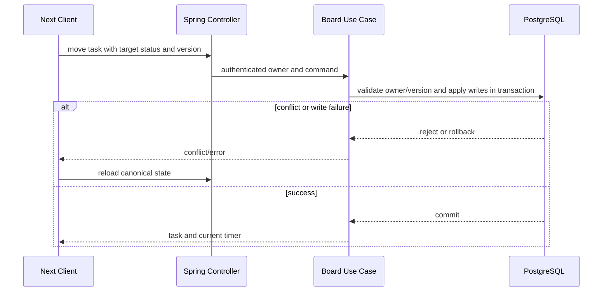

# แนวทาง Sequence และ Transaction

ใช้เมื่อเปลี่ยน feature ที่กระทบมุมมองนี้ อ่าน [กฎ diagrams](README.md) และ [feature workflow](../feature-workflow.md) ร่วมกัน

## กฎ implementation และ review

- แสดง intent, HTTP boundary, service orchestration, DB writes และ response/canonical state
- ระบุ transaction เริ่ม/commit/rollback และ alternative paths: owner/state/version/timer conflict
- ไม่แสดงหยุด timer และเปลี่ยน task เป็นคนละ transaction หาก requirement ต้อง atomic
- network failure หลัง server commit ต้องแยกจาก transaction rollback อย่า retry mutation เงียบ ๆ
- เพิ่ม/แก้/ลบ flow ให้ตรวจ consumers, failure paths และ tests ที่พิสูจน์ sequence behavior ตัวอย่างนี้เป็น target boundary

## ตัวอย่างเพื่อสื่อสารแนวทาง

ก่อนนำไปใช้เป็น diagram ปัจจุบัน ให้ระบุ source/commit ที่ตรวจและปรับ edges/guards ให้ตรง tests ตัวอย่างไม่แทน schema หรือสัญญา API
