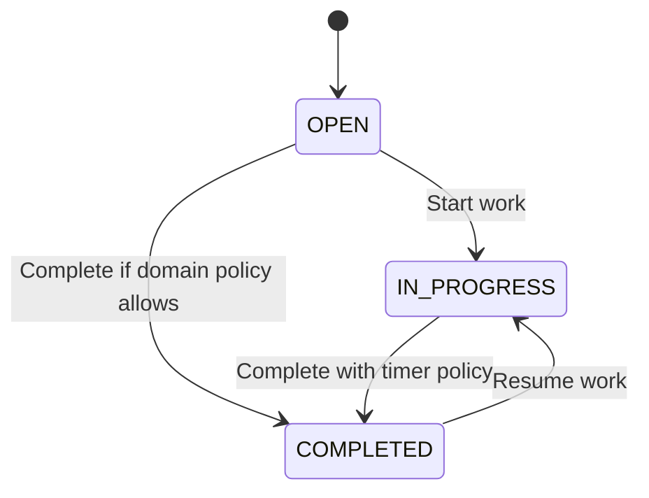

# แนวทาง State และ Transition Rules

ใช้เมื่อเปลี่ยน feature ที่กระทบมุมมองนี้ อ่าน [กฎ diagrams](README.md) และ [feature workflow](../feature-workflow.md) ร่วมกัน

## กฎ implementation และ review

- ระบุ current state, event, guard, side effect และ outcome ไม่มี unconditional transition ที่ bypass domain rule
- Task states ปัจจุบัน OPEN/IN_PROGRESS/COMPLETED งานที่เริ่มแล้วไม่ย้อน OPEN ตามกฎเดิม ถ้าจะเปลี่ยนต้อง requirement และ tests ก่อน
- Today เป็น membership ตาม date; timer state ไม่เท่ากับ IN_PROGRESS เพราะมีหลาย task กำลังทำแต่ timer ได้หนึ่ง
- Project states PLANNED/ACTIVE/ON_HOLD/COMPLETED/ARCHIVED ต้องตรวจ transitions จริง ไม่ใช้ตัวอย่าง Task แทน policy ของ Project
- เพิ่ม/แก้/ลบ state ต้อง migrate stored enums/filters/DTO/UI และระบุ historical behavior พร้อม compatibility

## ตัวอย่างเพื่อสื่อสารแนวทาง

ก่อนนำไปใช้เป็น diagram ปัจจุบัน ให้ระบุ source/commit ที่ตรวจและปรับ edges/guards ให้ตรง tests ตัวอย่างไม่แทน schema หรือสัญญา API
