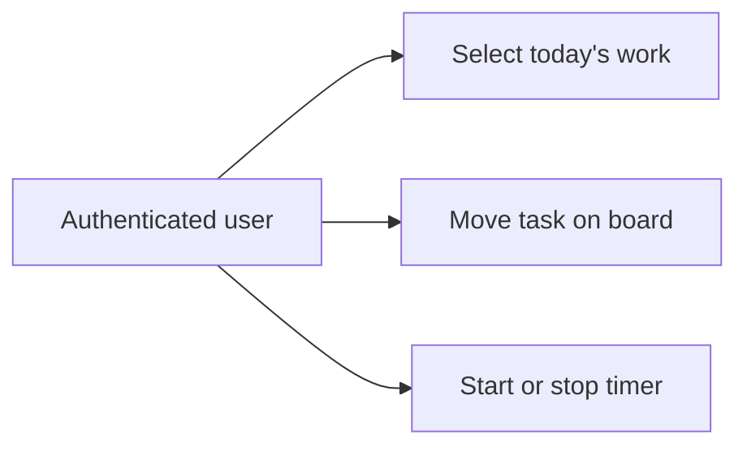

# แนวทาง Use Case

ใช้เมื่อเปลี่ยน feature ที่กระทบมุมมองนี้ อ่าน [กฎ diagrams](README.md) และ [feature workflow](../feature-workflow.md) ร่วมกัน

## กฎ implementation และ review

- แสดงผู้ใช้และ intent เช่นเลือกงานวันนี้ เริ่ม/หยุดเวลา หรือจัดการลูกค้า ไม่ใส่ class/table เป็น use case
- ระบุ authenticated scope และ ownership ทุก operation รวม read/search/export
- include/extend ใช้เมื่อความหมายสัมพันธ์จริง ไม่เชื่อมทุก CRUD เพื่อจัดหน้าให้สวย
- เพิ่ม feature ต้องมี criteria/negative paths; แก้ต้องแสดง actor/intent ที่เปลี่ยน; ลบต้องตรวจเมนู/deep links/API consumers และ deprecation

## ตัวอย่างเพื่อสื่อสารแนวทาง

ก่อนนำไปใช้เป็น diagram ปัจจุบัน ให้ระบุ source/commit ที่ตรวจและปรับ edges/guards ให้ตรง tests ตัวอย่างไม่แทน schema หรือสัญญา API
